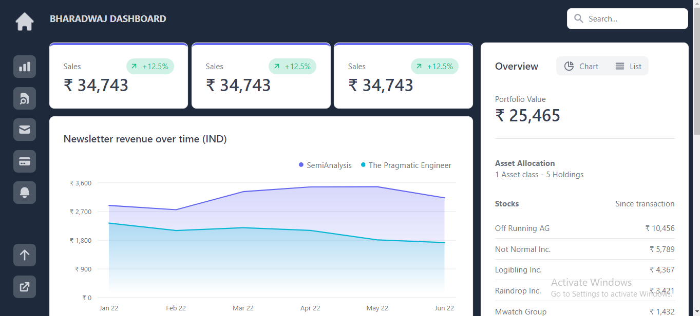
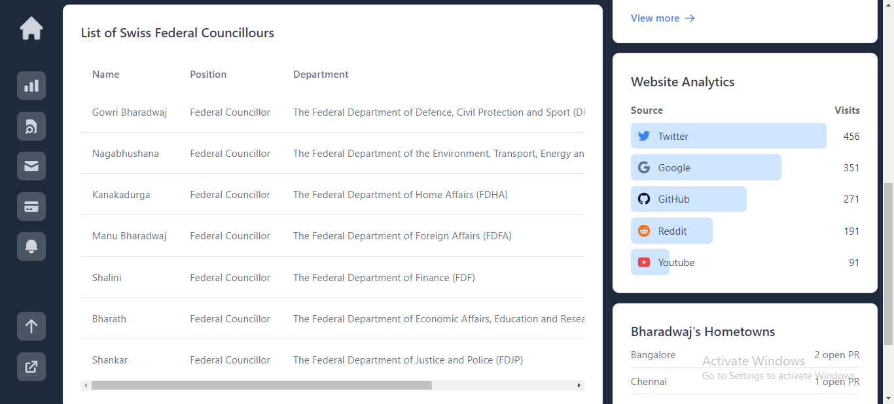
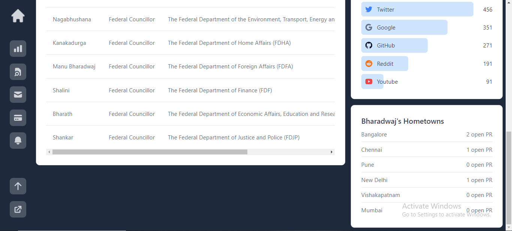

<div align="center">

# 📊 Bharadwaj Dashboard

### A modern, responsive analytics dashboard with a clean, dark-themed interface.

Summary cards, financial visualizations, web traffic analytics, and tabular data, built with **React**, **Vite**, **Tailwind CSS**, and **Tremor**.

[](https://react.dev/)
[](https://vitejs.dev/)
[](https://tailwindcss.com/)
[](https://www.tremor.so/)
[](#-contributing)

[Live Demo](#) · [Report a Bug](../../issues) · [Request a Feature](../../issues)

<!-- EDIT: deploy on Vercel or Netlify and replace the # above with your live URL -->



</div>

---

## 📖 Table of Contents

- [Overview](#-overview)
- [Features](#-features)
- [Screenshots](#-screenshots)
- [Tech Stack](#-tech-stack)
- [Getting Started](#-getting-started)
- [Project Structure](#-project-structure)
- [How It Works](#-how-it-works)
- [Customizing the Dashboard](#-customizing-the-dashboard)
- [Roadmap](#-roadmap)
- [Contributing](#-contributing)
- [Author](#-author)

---

## 🔭 Overview

**Bharadwaj Dashboard** brings together summary cards, financial visualizations, web traffic analytics, and tabular information in one responsive, dark-themed interface.

> **Note:** The dashboard uses sample data defined in its React components. It is a front-end UI project, not a live analytics or portfolio tracking service.

## ✨ Features

| | Feature | Description |
| --- | --- | --- |
| 📐 | **Responsive layout** | Navigation sidebar, top bar, and two-column content area that adapts to smaller screens |
| 💳 | **KPI cards** | Sales summary cards with currency values and change indicators |
| 📈 | **Revenue trends** | Interactive area chart comparing newsletter revenue across months |
| 🥧 | **Portfolio overview** | Portfolio value and asset allocation, with a tabbed switch between a donut chart and a holdings list |
| 🌐 | **Website analytics** | Bar list of traffic sources: Twitter, Google, GitHub, Reddit, and YouTube |
| 🗂️ | **Data table** | Styled table of sample Swiss Federal Council entries, departments, and status badges |
| 🏙️ | **Hometown list** | Compact list of cities with open-PR labels |
| 🔍 | **Search UI** | Search input in the top navigation (visual only; no filtering logic yet) |
| 🌑 | **Dark theme** | Slate-colored design with reusable Tremor components and Heroicons |

## 🖼️ Screenshots

<table>
  <tr>
    <td align="center"></td>
    <td align="center"></td>
  </tr>
  <tr>
    <td align="center" colspan="2"></td>
  </tr>
</table>

## 🛠️ Tech Stack

| Technology | Purpose |
| --- | --- |
| **React 18** | Component-based user interface |
| **Vite 5** | Development server and production builds |
| **Tailwind CSS 3** | Utility-first styling and responsive layouts |
| **Tremor** (`@tremor/react`) | Cards, charts, metrics, tables, lists, and tabs |
| **Heroicons** | Interface icons |
| **JavaScript / JSX** | Application logic and components |
| **ESLint** | Code linting |

## 🚀 Getting Started

### Prerequisites

- [Node.js](https://nodejs.org/) and npm installed on your machine (use a Node.js version compatible with Vite 5)

### Installation

```bash
# 1. Clone the repository
git clone https://github.com/Manu577228/React-Bharadwaj-Dashboard.git

# 2. Open the project folder
cd React-Bharadwaj-Dashboard

# 3. Install dependencies
npm install

# 4. Start the development server
npm run dev
```

Then open the local URL printed in your terminal (typically **http://localhost:5173**).

### Available Scripts

| Command | What it does |
| --- | --- |
| `npm run dev` | Starts the development server |
| `npm run build` | Creates an optimized production build |
| `npm run preview` | Previews the production build locally |
| `npm run lint` | Runs ESLint checks |

## 📁 Project Structure

```text
React-Bharadwaj-Dashboard/
├── public/
├── src/
│   ├── assets/
│   ├── components/
│   │   ├── AreaChartComponent.jsx  # Newsletter revenue chart
│   │   ├── CardItem.jsx            # Sales KPI card
│   │   ├── LeftColumn.jsx          # Metrics, chart, and table
│   │   ├── Navbar.jsx              # Dashboard title and search field
│   │   ├── RightColumn.jsx         # Portfolio, analytics, and list
│   │   ├── SalesItem.jsx           # Portfolio donut chart / list tabs
│   │   ├── ScoreList.jsx           # Hometown list
│   │   ├── Sidebar.jsx             # Sidebar navigation visuals
│   │   ├── TableComponent.jsx      # Sample councillor table
│   │   └── WebAnalytics.jsx        # Traffic source analytics
│   ├── App.jsx                     # Main dashboard layout
│   ├── index.css                   # Global styles and Tailwind directives
│   └── main.jsx                    # React entry point
├── Sample-UI-1.PNG
├── Sample-UI-2.PNG
├── Sample-UI-3.PNG
├── index.html
├── package.json
├── tailwind.config.js
└── vite.config.js
```

## 🧩 How It Works

`App.jsx` composes the dashboard from four building blocks: `Sidebar`, `Navbar`, `LeftColumn`, and `RightColumn`. Each dashboard section is a self-contained React component.

```text
App.jsx
├── Sidebar
├── Navbar
├── LeftColumn
│   ├── CardItem (KPI cards)
│   ├── AreaChartComponent
│   └── TableComponent
└── RightColumn
    ├── SalesItem (donut chart / list tabs)
    ├── WebAnalytics
    └── ScoreList
```

- **Tremor** provides the area chart, donut chart, metrics, bar list, tables, badges, and tabs.
- **Tailwind CSS** handles spacing, typography, colors, and responsive grid behavior.
- **React state** controls the Chart/List toggle inside the portfolio overview.
- **Sample datasets** live directly inside the components, so customizing values is straightforward.

## 🎨 Customizing the Dashboard

Because the data lives inside the components, you can make the dashboard your own without touching any backend.

| I want to change... | Edit this file |
| --- | --- |
| KPI card values | `src/components/LeftColumn.jsx` / `CardItem.jsx` |
| Revenue chart data | `src/components/AreaChartComponent.jsx` |
| Portfolio allocation | `src/components/SalesItem.jsx` |
| Traffic sources | `src/components/WebAnalytics.jsx` |
| Table rows | `src/components/TableComponent.jsx` |
| City list | `src/components/ScoreList.jsx` |
| Colors and theme | `tailwind.config.js` and `src/index.css` |

<!-- EDIT: confirm where each dataset actually lives in your components and adjust this table -->

## 🗺️ Roadmap

- [ ] Connect the charts and metrics to a real backend or analytics API
- [ ] Add working search and filters
- [ ] Make sidebar icons navigate to dedicated views
- [ ] Add configurable date ranges and dashboard widgets
- [ ] Add loading, empty, and error states for API-driven data

Have an idea? [Open an issue](../../issues) and let's discuss it.

## 🤝 Contributing

Contributions, bug reports, and suggestions are welcome.

1. **Fork** the repository
2. **Create** a feature branch: `git checkout -b feature/amazing-feature`
3. **Commit** your changes: `git commit -m "Add amazing feature"`
4. **Push** to your fork: `git push origin feature/amazing-feature`
5. **Open a Pull Request**

For major changes, please open an issue first to discuss what you'd like to change.

## 👨‍💻 Author

**Manu Bharadwaj**, Software Engineer

[](https://www.linkedin.com/in/manu-bharadwaj-3507a345/)
[](https://www.youtube.com/@code-with-Bharadwaj)
[](https://github.com/Manu577228)

---

<div align="center">

### ⭐ If you find this project useful, please star the repository!

Made with ❤️ using React, Vite, Tailwind CSS, and Tremor

</div>
